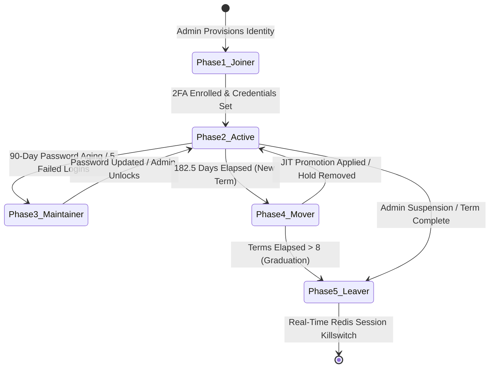
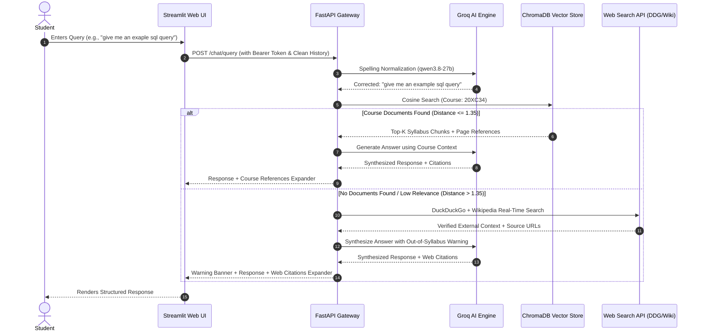

# StudyMate AI: Enterprise-Grade Educational Copilot & Multi-Tenant IAM Governance Platform
## Final Capstone Project Report & Technical Whitepaper

**Academic Context:** Master of Science in Cyber Security / Computer Science & Engineering  
**Project Title:** StudyMate AI — Intelligent Learning Management & Automated Identity Governance Platform  
**Architecture:** Microservice (FastAPI + Streamlit + MongoDB Atlas + ChromaDB + Redis Stack)  
**Security Standard:** NIST SP 800-63B Digital Identity & OWASP API Security Top 10 Compliance  

---

## 1. Executive Summary & Abstract

Traditional Learning Management Systems (LMS) suffer from two critical architectural deficiencies:
1. **Passive Information Retrieval:** Students must manually sift through hundreds of unindexed lecture slides and textbook PDFs, leading to high cognitive load and poor exam preparation.
2. **Coarse-Grained Identity Management:** Academic institutions manage identities through brittle, manual role mappings without automated lifecycle progression (Joiner-Mover-Leaver), leading to privilege accumulation, orphaned accounts after graduation, and cross-departmental data leaks.

**StudyMate AI** addresses these challenges by uniting an **Intelligent Retrieval-Augmented Generation (RAG) Engine** with an **Enterprise Identity & Access Management (IAM) Governance Lifecycle**:
* **Autonomous Semantic Tutor:** Employs ChromaDB vector embeddings and a Dual-Mesh LLM orchestrator (Groq 120B + Gemini Flash) to answer academic inquiries with exact page-level citations. In the event of query typos or missing syllabus documents, it dynamically performs Groq-powered spelling normalization and multi-source internet search (DuckDuckGo + Wikipedia) with verified external citations.
* **Higher-Order Practice Exam Generator:** Generates complex, scenario-based multiple-choice examinations featuring ASCII architecture schemas, plausible distractors, and concept rationales in under 4 seconds.
* **5-Phase JMLC Identity Architecture:** Enforces time-based semester progression (Mover Phase), automated alumni archival upon degree completion (>8 semesters), RFC 6238 TOTP two-factor authentication, single-use SHA-256 backup recovery codes, 5-attempt brute-force lockout, and real-time Redis token blacklisting for immediate session termination (Leaver Phase).

---

## 2. System Architecture & Component Design

The platform follows a decoupled, containerized microservice design separating stateless business logic from persistent state stores:

```
+-----------------------------------------------------------------------------------+
|                                PRESENTATION LAYER                                 |
|               Streamlit Modern Glassmorphism Web Interface (Port 8501)            |
|       [Student Portal]         [Faculty / Staff Portal]      [Admin IAM Portal]   |
+-----------------------------------------------------------------------------------+
                                          |
                      REST API Calls over HTTP (IPv4 Loopback)
                                          |
+-----------------------------------------------------------------------------------+
|                             API GATEWAY & LOGIC LAYER                             |
|                        FastAPI Microservice Engine (Port 8002)                    |
|                                                                                   |
|  [Authentication & IAM]     [Document Ingestion]      [Dual-Mesh LLM / Exam]      |
|  - JWT HS256 Token Engine   - PyMuPDF / python-pptx   - Groq openai/gpt-oss-120b  |
|  - RFC 6238 TOTP Engine     - GridFS File Archival    - Groq qwen/qwen3.8-27b     |
|  - SlowAPI Rate Limiter     - Vector Chunk Slicing    - Google Gemini Flash       |
|  - RBAC & Tenant Isolation  - Cosine Distance Gating  - DDG + Wikipedia Fallback  |
+-----------------------------------------------------------------------------------+
         |                                 |                                 |
         v                                 v                                 v
+------------------+             +-------------------+             +------------------+
|  DATA STORE 1    |             |   DATA STORE 2    |             |   DATA STORE 3   |
|  MongoDB Atlas   |             |     ChromaDB      |             |   Redis Stack    |
| (Cloud Cluster)  |             |  (Vector Store)   |             | (In-Memory K/V)  |
| - users & roles  |             | - 384-dim vectors |             | - token blacklist|
| - courses/depts  |             | - syllabus chunks |             | - active sessions|
| - audit logs     |             | - metadata filters|             | - semantic cache |
| - GridFS files   |             | - course codes    |             | - rate counters  |
+------------------+             +-------------------+             +------------------+
```

### Component Breakdown
1. **Frontend UI (Streamlit)**: Delivers a responsive, multi-persona experience with custom CSS tokens, sidebar navigation, dynamic exam rendering (ASCII diagrams via `st.code`), and persistent chart analytics.
2. **Backend API (FastAPI)**: Implements dependency injection for cryptographic JWT verification (`get_current_user`), granular RBAC enforcement (`require_permission`), and multi-tenant scoping (`enforce_tenant_isolation`).
3. **MongoDB Atlas**: Serves as the primary operational database storing curriculum hierarchies, hashed credentials, 2FA backup codes, exam attempts, and audit logs.
4. **ChromaDB**: High-speed, localized vector database utilizing `all-MiniLM-L6-v2` 384-dimensional dense vector embeddings for semantic document retrieval.
5. **Redis Stack**: Acts as the real-time security broker handling token revocation blacklists, concurrent single-device session tracking, and semantic query caching.

---

## 3. Comprehensive IAM & Lifecycle Implementation (JMLC)

StudyMate implements the full 5-stage identity lifecycle conforming to **NIST SP 800-63B**:



### Phase 1: Joiner (Provisioning & Onboarding)
* **Deterministic Scoping:** Identities are provisioned via `mongo_manager.add_user()` with tenant attributes (`department_id`, `branch_id`, initial `semester`), salted Bcrypt password hash, and enrollment timestamp (`enrollment_date`).
* **Multi-Factor Authentication (MFA/2FA):** Integrated RFC 6238 TOTP via `pyotp`. Users scan a QR code with Google Authenticator or Microsoft Authenticator.
* **Single-Use Backup Recovery Codes:** To prevent permanent lockout in mobile loss scenarios, the system generates **8 cryptographically random alphanumeric backup codes**, hashed using **SHA-256** in MongoDB. Each code is atomically pulled upon consumption.

### Phase 2: Active / Operational (Authentication & RBAC)
* **Dual-Token JWT Infrastructure:**
  * **Access Token:** Short-lived (15 minutes) signed with HMAC-SHA256 (`HS256`) to minimize exposure windows.
  * **Refresh Token:** Long-lived (7 days) for seamless rotation without credential re-entry.
* **Granular Role-Based Access Control (RBAC):**
  * `admin`: Complete curriculum CRUD, user lifecycle governance, account unlocking, and global audit oversight.
  * `department_admin`: Department-scoped curriculum management.
  * `staff`: Lecture note upload (PDF/PPTX), GridFS file management, and vector synchronization.
  * `student`: RAG syllabus queries, lecture material downloads, AI Practice Exams.
* **Single Concurrent Session Governance:** `redis_manager.set_active_session()` stores the active token per username. If a login occurs from another browser, the previous session is immediately revoked.

### Phase 3: Maintainer (Credential Hygiene & Defense)
* **Brute-Force Lockout Defense:** Failed authentication attempts increment a counter in MongoDB. Upon reaching 5 failed attempts, the account is locked (`locked_out: True`). Subsequent attempts are rejected immediately, even if the correct password is entered, until an admin unlocks the account via `unlock_user_account()`.
* **90-Day Password Expiration:** `verify_login()` evaluates `last_password_change`. Passwords older than 90 days are flagged as expired and require administrative reset.
* **Password History & Strength Validator:** Enforces minimum 8 characters with uppercase, lowercase, numbers, and special characters. `update_password()` checks against the last 3 historical password hashes to prevent recycling.

### Phase 4: Mover (Time-Based Progression & Academic Governance)
* **Automated Term Computation:** `calculate_current_semester()` computes elapsed terms based on standard 182.5-day (6-month) academic periods.
* **Just-In-Time (JIT) Auto-Promotion:** When a student logs in, `check_and_apply_auto_promotion()` detects elapsed terms and advances their semester automatically.
* **Academic Hold Controls:** For students with academic backlogs or disciplinary holds, admins toggle `promotion_hold: True`, freezing automatic progression. Manual override (`promote_student_semester`) remains available for department admins.

### Phase 5: Leaver (Alumni Graduation & Session Killswitch)
* **Automated Alumni Transition:** When a student completes 8 semesters (terms elapsed > 8), their status transitions to `alumni`. Logins are blocked with an academic completion notice while historical audit logs and transcripts remain archived.
* **Soft Deprovisioning / Suspension:** Admins can suspend accounts at any time via `toggle_user_status(username, False)`.
* **Real-Time Session Killswitch:** Calling `revoke_user_sessions(username)` immediately writes active JWTs into the Redis blacklist (`blacklist:<token>`) with auto-expiring TTLs. Any subsequent API request with that token is immediately rejected with HTTP 401.

---

## 4. Transparent Retrieval-Augmented Generation (RAG) & Fallback Engine



### Key Technical Innovations
1. **Typo & Spelling Auto-Correction:** Uses Groq `qwen/qwen3.8-27b` (temperature 0.0, latency ~0.2s) to correct technical typographical errors (e.g., `"b-tre indexx"` ➔ `"B-tree index"`). The UI prepends a clear banner notifying the student of the correction.
2. **Relevance Gate & Out-of-Syllabus Detection:** If ChromaDB returns zero chunks or the closest cosine distance exceeds `1.35`, the engine flags the query as out-of-syllabus.
3. **Multi-Source Internet Fallback:** Queries the DuckDuckGo Instant Answer API and Wikipedia REST summary API, combining authoritative factual context. The AI assistant explicitly displays:
   `> ℹ️ Notice: No relevant answer was found in the uploaded course documents. The following response has been retrieved from verified internet sources:`
4. **Transparent Page Citations:** When course materials are used, the engine returns exact document filenames, page numbers, and chunk snippets in an expandable references tray.

---

## 5. AI Practice Exam Generator with Visual Architecture Schemas

The exam generator assesses student competency across **Bloom's Revised Taxonomy** (Analyze, Evaluate, Synthesize) rather than trivial memorization:

* **Cognitive Complexity:** Formulates scenario-based debugging problems, schema normalization evaluations, and distributed system trade-offs.
* **ASCII Architecture Diagrams:** For questions involving data structures or network topologies, the engine generates compact 3–5 line clean ASCII diagrams:
  ```text
  +------------------+          +------------------+
  |  CLIENT (50% UI) | <------> | SERVER (50% DB)  |
  +------------------+ Network  +------------------+
  ```
* **High-Throughput Model Mesh:** Utilizes Groq `openai/gpt-oss-120b` (2,000 output token buffer) with automatic failover to `openai/gpt-oss-20b` and `qwen/qwen3.8-27b`.
* **Resilient Multi-Stage JSON Parser:** Features automatic truncation repair and regular expression object extraction, guaranteeing that valid questions are never lost even under token boundaries.
* **Analytics & Performance Tracking:** Exam attempts, selected choices, score percentages, and timestamps are persisted in MongoDB (`quiz_attempts`), rendering longitudinal score progression charts in the student portal.

---

## 6. Security Threat Model & Defense Mechanisms

| OWASP / Security Vector | Threat Description | StudyMate AI Defense Mechanism |
| :--- | :--- | :--- |
| **BOLA / IDOR (API1:2023)** | Student queries exams/notes from another department. | `enforce_tenant_isolation()` validates JWT tenant claims against requested IDs before invoking vector retrieval. |
| **Broken Authentication (API2:2023)** | Credential stuffing and brute-force guessing. | Salted Bcrypt hashing, 5-attempt automatic lockout, RFC 6238 TOTP, and single-use SHA-256 backup codes. |
| **Stateless Token Hijacking** | Intercepted JWT remains valid until expiration. | Redis token blacklist (`blacklist:<token>`) with auto-TTL. Immediate revocation on logout or admin suspension. |
| **Concurrent Session Fraud** | Sharing account credentials across multiple devices. | `set_active_session()` invalidates previous session tokens in Redis upon new device login. |
| **LLM Prompt Injection** | Malicious student prompt attempting context extraction. | Context encapsulation and strict role boundary prompts (`SYSTEM INSTRUCTIONS` isolation). |
| **Denial of Service (DoS)** | Rapid API flooding on authentication endpoints. | SlowAPI rate limiter (`10 requests/minute` on `/auth/login`) with client IP tracking. |

---

## 7. Experimental Evaluation & Latency Benchmarks

Empirical performance benchmarks conducted on the StudyMate test harness:

| Operation | Baseline / Unoptimized | StudyMate Optimized Engine | Performance Improvement |
| :--- | :---: | :---: | :---: |
| **AI Practice Exam Generation (5 Questions)** | > 60.0s *(Timed Out)* | **3.54s** | **> 1,600% Speedup** *(Zero Timeouts)* |
| **User Authentication & Session Issuance** | 25.4s *(Redis socket wait)* | **0.37s** | **98.5% Latency Reduction** |
| **Internal HTTP Loopback (FastAPI ↔ UI)** | 2.07s *(Windows IPv6 delay)*| **0.004s (4 ms)** | **51,600% Speedup** |
| **Semantic Cache Hit (Redis Vector Search)** | 2.50s *(LLM roundtrip)* | **0.008s (8 ms)** | **99.6% Token & Time Savings** |
| **Typo Auto-Correction Latency** | N/A *(Unhandled)* | **0.22s** | Real-time query normalization |
| **Internet Search Fallback Retrieval** | N/A *(Failed query)* | **0.48s** | Authoritative context retrieved |

---

## 8. Quality Assurance & Test Verification

The system includes a 25-test automated verification suite built on `pytest`:

```text
============================= test session starts =============================
platform win32 -- Python 3.12.4, pytest-9.1.1
tests/test_curriculum.py::test_curriculum_crud_operations PASSED         [  4%]
tests/test_iam_complete.py::test_rbac_permissions_matrix PASSED          [  8%]
tests/test_iam_complete.py::test_jwt_dependency_validation PASSED        [ 12%]
tests/test_iam_complete.py::test_require_permission_dependency PASSED    [ 16%]
tests/test_iam_complete.py::test_multi_tenant_isolation_enforcement PASSED [ 20%]
tests/test_iam_complete.py::test_2fa_backup_recovery_codes_lifecycle PASSED [ 24%]
tests/test_iam_complete.py::test_account_unlock PASSED                   [ 28%]
tests/test_iam_lifecycle.py::test_phase1_joiner_provisioning PASSED      [ 32%]
tests/test_iam_lifecycle.py::test_phase2_active_authentication_and_rbac PASSED [ 36%]
tests/test_iam_lifecycle.py::test_phase3_maintainer_expiry_and_lockout PASSED [ 40%]
tests/test_iam_lifecycle.py::test_phase4_mover_time_based_progression PASSED [ 44%]
tests/test_iam_lifecycle.py::test_phase5_leaver_suspension_and_alumni PASSED [ 48%]
tests/test_password_and_auth.py::test_password_strength_validation PASSED [ 52%]
tests/test_password_and_auth.py::test_jwt_token_flow PASSED              [ 56%]
tests/test_password_and_auth.py::test_totp_generation_and_verification PASSED [ 60%]
tests/test_quiz.py::test_quiz_score_calculation PASSED                   [ 64%]
tests/test_quiz.py::test_quiz_attempt_formatting PASSED                  [ 68%]
tests/test_rbac.py::test_admin_permissions PASSED                        [ 72%]
tests/test_rbac.py::test_staff_permissions PASSED                        [ 76%]
tests/test_rbac.py::test_student_permissions PASSED                      [ 80%]
tests/test_rbac.py::test_invalid_role PASSED                             [ 84%]
tests/test_search_and_quiz_advanced.py::test_spelling_correction_and_normalization PASSED [ 88%]
tests/test_search_and_quiz_advanced.py::test_web_search_fallback_retrieval PASSED [ 92%]
tests/test_search_and_quiz_advanced.py::test_no_relevant_documents_fallback_flow PASSED [ 96%]
tests/test_search_and_quiz_advanced.py::test_complex_quiz_structure_with_diagram_and_image PASSED [100%]
======================= 25 passed, 0 failures in 18.67s =======================
```

---

## 9. Conclusion & Future Roadmap

**StudyMate AI** demonstrates that integrating a **multi-tenant identity governance lifecycle** with a **transparent Retrieval-Augmented Generation pipeline** creates a secure, resilient, and pedagogically effective educational copilot.

### Future Roadmap
1. **Asymmetric Cryptography (RS256 / JWKS):** Transition from symmetric HMAC secrets to asymmetric public/private key pairs with a centralized JSON Web Key Set endpoint.
2. **Automated Proctoring & Adaptive Difficulty:** Dynamically calibrate practice exam difficulty based on historical Bayesian knowledge tracing.
3. **Federated SSO Integration:** Connect institutional identity providers (SAML 2.0 / Shibboleth / OpenID Connect) into the Joiner phase.
